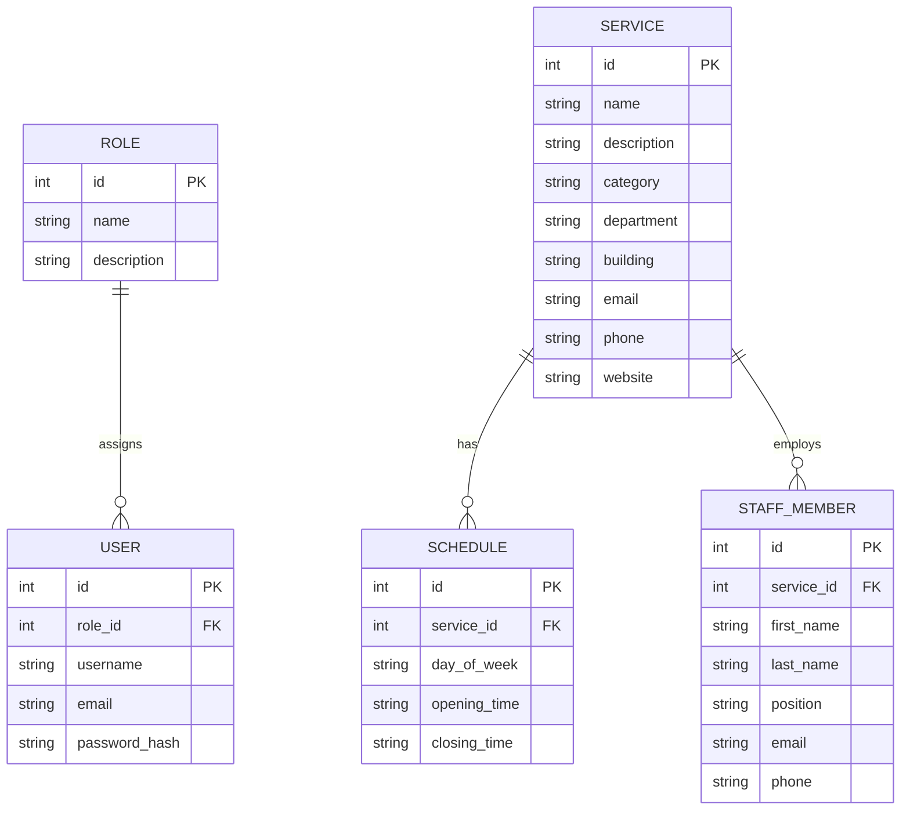

# University Health — Architecture & Data Model

## 1. Project Overview

University Health (UES) is a Full-Stack web application and REST API designed to provide structured university health and wellness services through a centralized platform.

### Key Features

- **Frontend**: Single Page Application built with React, Vite, TypeScript, and Tailwind CSS.
- **Backend**: Asynchronous REST API built with FastAPI and SQLAlchemy (Asyncpg).
- **Authentication & Security**: OAuth2 JWT Bearer Tokens with client-side session persistence in `localStorage` and Role-Based Access Control (RBAC).

---

## 2. Architecture

The application follows a decoupled client-server architecture with clear separation of concerns:

```text
┌─────────────────────────────────────────────────────────┐
│                    React Frontend                       │
│  (AuthContext, State Management, Role-Based Views)      │
└────────────────────────────┬────────────────────────────┘
                             │
                             │ HTTP / JSON (Vite Proxy)
                             ▼
┌─────────────────────────────────────────────────────────┐
│                   FastAPI Backend                       │
│  (Routers, Middleware, JWT Verification)                │
└────────────────────────────┬────────────────────────────┘
                             │
                             │ Async Sessions (SQLAlchemy)
                             ▼
┌─────────────────────────────────────────────────────────┐
│                PostgreSQL Database                      │
│  (Roles, Users, Services, Staff Members, Schedules)     │
└─────────────────────────────────────────────────────────┘

```

---

## 3. Technology Stack

### Frontend

- React 18+
- TypeScript
- Vite
- Tailwind CSS

### Backend

- Python 3.12
- FastAPI
- Pydantic v2
- SQLAlchemy 2.0 (Async Engine)
- Asyncpg
- PyJWT & Passlib / Bcrypt

### Database & Infrastructure

- PostgreSQL 16
- Docker & Docker Compose
- Dev Containers (VS Code)

---

## 4. Backend Project Structure

```text
backend/
│
├── app/
│   ├── api/                  # API Routers / Endpoints
│   │   └── routes/
│   ├── authentication/       # OAuth2 / JWT authentication handlers
│   ├── authorization/        # Role guards & permission helpers
│   ├── core/                 # App configuration & security settings
│   ├── db/                   # Database session and connection setup
│   ├── models/               # Active SQLAlchemy ORM Models
│   │   ├── role.py
│   │   ├── schedule.py
│   │   ├── service.py
│   │   ├── staff_member.py
│   │   └── user.py
│   ├── schemas/              # Pydantic schemas (Validation)
│   ├── services/             # Business logic layer
│   └── main.py               # FastAPI entrypoint
│
├── seeds/                    # Database seeding scripts (SQL)
├── alembic.ini               # Database migrations configuration
├── pyproject.toml
└── uv.lock

```

---

## 5. Active Database Models

The relational data model consists of 5 active entities defined in `app/models/`:

- **Role** (`role.py`): Defines system privileges (`ADMIN`, `STAFF`, `STUDENT`).
- **User** (`user.py`): Stores user credentials, hashed passwords, and assigned `role_id`.
- **Service** (`service.py`): Represents university services (Health, Psychology, Sports).
- **StaffMember** (`staff_member.py`): Medical and administrative staff members linked to services/departments.
- **Schedule** (`schedule.py`): Operating hours for university services.

---

## 6. Entity Relationship Diagram (ERD)



---

## 7. Authentication & Role-Based Access Control (RBAC)

### Authentication Flow

1. **Credentials Submission**: Client posts credentials to `/api/v1/auth/login` as a JSON payload.
2. **Verification & Token Issue**: FastAPI verifies credentials using `bcrypt` and returns a JWT `access_token`.
3. **Profile Retrieval**: Client requests user profile from `/api/v1/auth/me` with `Authorization: Bearer <token>`.
4. **Session Persistence**: Client stores token and user object in `localStorage` via `AuthContext`.

### Role Permissions

| Role        | Role ID | Scope & Access Privileges                                  |
| ----------- | ------- | ---------------------------------------------------------- |
| **ADMIN**   | 1 or 5  | Full CRUD operations on services, users, and schedules.    |
| **STAFF**   | 2       | Management of department appointments and operating hours. |
| **STUDENT** | 3       | Read-only access to available services and contacts.       |

---

## 8. API Endpoints Summary

### Authentication

| Method | Endpoint             | Description                            | Access Level  |
| ------ | -------------------- | -------------------------------------- | ------------- |
| `POST` | `/api/v1/auth/login` | Authenticate user and issue JWT token. | Public        |
| `GET`  | `/api/v1/auth/me`    | Retrieve current user profile details. | Authenticated |

### Services

| Method   | Endpoint                | Description                             | Access Level  |
| -------- | ----------------------- | --------------------------------------- | ------------- |
| `GET`    | `/api/v1/services`      | List all active university services.    | Public        |
| `GET`    | `/api/v1/services/{id}` | Get detailed service information by ID. | Public        |
| `POST`   | `/api/v1/services`      | Create a new university service.        | ADMIN         |
| `PUT`    | `/api/v1/services/{id}` | Update existing service details.        | ADMIN / STAFF |
| `DELETE` | `/api/v1/services/{id}` | Remove a service from the system.       | ADMIN         |

```

```
